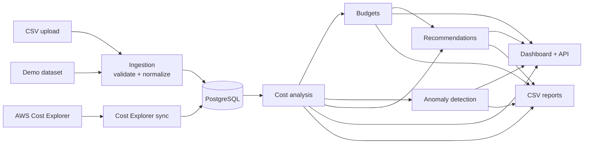

# Cloud Cost Optimization Platform

A Java 21 / Spring Boot application that helps engineering teams understand AWS spending. It
ingests daily cost data (from AWS Cost Explorer or a documented CSV format), breaks it down by
service and environment, tracks budgets, flags unusual cost increases with explainable rules, and
produces evidence-based optimization recommendations and CSV reports.

## The problem

Cloud bills grow in ways that are hard to see from the billing console alone: a service creeps up
by 30% over a month, a batch job misconfiguration doubles NAT gateway charges for two days,
development environments run all weekend, and a tenth of the spend carries no tag that says who
owns it. This platform turns daily cost data into those answers, and is explicit about what billing
data can and cannot prove.

## Features

| Feature | Status | Needs AWS? |
| --- | --- | --- |
| Overview dashboard: totals, previous period, change, daily and monthly trends, service and environment breakdowns, largest increases, budget utilization, open findings | Implemented | No |
| Cost Explorer page (filter by period, service, environment incl. untagged) and Service Breakdown page | Implemented | No |
| CSV import of daily costs with row-level validation, normalization and idempotency | Implemented | No |
| Optional CSV import of resource utilization (CPU) measurements | Implemented | No |
| Clearly labeled demonstration dataset (fictional) | Implemented | No |
| AWS Cost Explorer synchronization (`GetCostAndUsage`, daily, by service and environment tag), manual or scheduled | Implemented, disabled by default | Yes: credentials with `ce:GetCostAndUsage` |
| Budgets (monthly/quarterly/annual, optional service/environment scope) with NORMAL / WARNING / EXCEEDED | Implemented | No |
| Rule-based anomaly detection with review workflow | Implemented | No |
| Webhook notifications for new anomalies (Slack, Teams, Google Chat, Mattermost) | Implemented, disabled by default | No |
| Month-end spend forecast (linear and recent run rate) | Implemented (API) | No |
| Optimization recommendations (5 rules) with evidence, interpretation and savings basis | Implemented | No (utilization rules need uploaded measurements) |
| CSV reports (summary and daily detail, optionally per service/environment; anomalies; recommendations) | Implemented | No |
| REST API (`/api/**`, HTTP Basic) | Implemented | No |
| Terraform for ECS Fargate, RDS, ALB, ECR; GitHub Actions CI and OIDC deployment | Provided, **not applied** | Yes |

Every figure shown comes from stored data. When the demonstration dataset is loaded, every page
shows a banner and CSV reports carry a notice, because those figures are fictional.

## Architecture



A modular monolith: one Spring Boot application with packages per capability (`ingestion`, `aws`,
`analysis`, `budget`, `anomaly`, `notification`, `recommendation`, `report`, `web`) and one PostgreSQL database.
See [docs/architecture.md](docs/architecture.md) for the data model, uniqueness rules and
deployment diagram.

## Technology

Java 21 · Spring Boot 3.5 (Web, Data JPA, Validation, Security, Actuator) · Thymeleaf with
server-rendered SVG charts (no JavaScript) · PostgreSQL 17 · Flyway · AWS SDK for Java v2 ·
Apache Commons CSV · JUnit 5, Mockito, Spring Boot Test, embedded PostgreSQL for integration tests ·
Docker · Terraform · GitHub Actions.

## Quick start (no AWS account needed)

```bash
cp .env.example .env          # set POSTGRES_PASSWORD and APP_ADMIN_PASSWORD
docker compose up --build
```

Open <http://localhost:8080>, sign in as `admin`, go to **Data Sources → Load demonstration data**
(or run `APP_ADMIN_PASSWORD=... scripts/import-sample-data.sh`), then explore the Overview,
Cost Anomalies and Recommendations pages.

Running without Docker, PostgreSQL setup, configuration and the CSV workflow are described in
[docs/local-development.md](docs/local-development.md).

### CSV import

```csv
usage_date,service,amount,currency,environment,account_id,region,charge_type
2026-09-01,AmazonEC2,61.7231,USD,prod,111122223333,us-east-1,USAGE
2026-09-01,Amazon S3,-12.40,USD,production,111122223333,us-east-1,REFUND
```

- Required: `usage_date` (UTC, `YYYY-MM-DD`), `service`, `amount`, `currency`.
- Service aliases are mapped to Cost Explorer names; environments are lower-cased with
  `prod`/`dev`/`stg` aliases; negative amounts are allowed only for credits and refunds.
- A file with any invalid row is rejected entirely, with row and column in every message.
- Identical file content is rejected as a duplicate; rows that already exist are skipped, so
  overlapping exports are safe. Every attempt is recorded with source, counts and UTC timestamps.

Full format: [sample-data/README.md](sample-data/README.md).

## AWS Cost Explorer integration

Optional and off by default. Enable with `COSTPLATFORM_AWS_ENABLED=true`; credentials come from the
AWS SDK default provider chain (IAM role, profile), never from configuration. Minimum permission:

```json
{ "Effect": "Allow", "Action": "ce:GetCostAndUsage", "Resource": "*" }
```

Cost Explorer must be enabled, the `Environment` tag activated as a cost allocation tag, and each
paginated API request is billed (USD 0.01). Data is grouped by service and environment tag only
(Cost Explorer allows two group-by keys). Details, pricing and data availability:
[docs/aws-integration.md](docs/aws-integration.md).

## How the numbers are calculated

- **Periods** are inclusive UTC days, compared with the preceding period of equal length.
  Percentages are not invented for zero baselines; data gaps are shown as gaps, not zeros.
- **Budgets**: EXCEEDED at spend ≥ limit; WARNING at spend ≥ threshold × limit (exact comparison);
  linear run-rate projection after seven days.
- **Forecast**: month-to-date spend projected linearly and from the last seven days' average; shown
  after seven elapsed days, clearly labeled as a projection.
- **Anomalies**: a day is flagged when its cost is at least 50% *and* at least 25.00 above the
  median of the previous 14 days with data; severity by absolute increase. Rule-based, configurable,
  with a reproducible reason stored on every finding.
- **Recommendations**: sustained service increases, always-on non-production spend, untagged spend,
  budget overruns, and low-CPU or near-idle resources (only with uploaded utilization data). Each
  separates observed evidence from interpretation, and savings are estimated only when the data
  supports a figure. The platform never modifies AWS resources.

Full methodology, thresholds and the CSV report layout: [docs/cost-analysis.md](docs/cost-analysis.md).

## Infrastructure and deployment

`infra/terraform/bootstrap` creates the state bucket (S3 native locking) and a GitHub OIDC deploy
role; `infra/terraform/app` creates a VPC with isolated database subnets, an ALB restricted to
chosen CIDRs (HTTPS by default), ECS Fargate, ECR, encrypted RDS PostgreSQL with an RDS-managed
password, least-privilege IAM, Secrets Manager, CloudWatch logs and alarms. Estimated cost is about
USD 95–105/month (prod settings) or USD 60–70 (dev settings without NAT).
**These resources incur charges; nothing was applied while building this repository.**
Step-by-step guide: [docs/deployment.md](docs/deployment.md).

## CI/CD

| Workflow | Trigger | AWS access |
| --- | --- | --- |
| `ci.yml` – Maven verify (compile with lint, enforcer, 212 tests, JaCoCo coverage floor) and Docker build | push, pull request | none |
| `terraform.yml` – `fmt -check` and `validate` | changes under `infra/` | none |
| `deploy.yml` – test, build, push to ECR, deploy to ECS | manual, `production` environment | GitHub OIDC role |

Actions are pinned to commit SHAs with read-only default permissions; Dependabot updates them.

## Testing

```bash
./mvnw verify
```

212 tests covering money math, period comparisons, budgets and thresholds, forecasts, CSV
validation, idempotent ingestion, Cost Explorer mapping and error handling (mocked AWS), anomaly
detection and notifications (mocked webhook), every recommendation rule, reports, API validation,
security and page rendering. Integration tests run the real Flyway migrations on an embedded
PostgreSQL 17 binary, so no Docker, database server or AWS account is needed.

JaCoCo writes a coverage report to `target/site/jacoco/index.html` and fails the build below 80%
line coverage (currently about 87% of lines and 78% of branches).

## Security

Single operator account (form login for the UI, HTTP Basic for the API), CSRF protection, strict
Content Security Policy, problem-detail errors without internals, no committed secrets, secrets in
AWS Secrets Manager, least-privilege IAM and OIDC instead of access keys. See
[docs/security.md](docs/security.md).

## Known limitations

- **One reporting currency**; data in other currencies is rejected, not converted.
- **Single operator account**; no per-user roles, audit trail or SSO.
- Cost Explorer data has **no account or region breakdown** (two group-by keys: service and
  environment tag), no resource-level or hourly data, and only covers the history Cost Explorer
  retains.
- Utilization data must be **uploaded as CSV**; there is no CloudWatch or resource inventory
  integration. Without it, no sizing or idle-resource recommendations are produced.
- Anomaly detection is daily and rule-based: it does not model seasonality beyond 14 days and stops
  flagging a step change once it becomes the baseline.
- Budget projections are linear; there is no forecasting model.
- Notifications cover new anomalies only, through one webhook; there is no email delivery and no
  notification for budget states.
- The month-end forecast is a run-rate extrapolation available through the API; it does not model
  seasonality, planned changes or charges billed once per month.
- Figures from all sources are added together; loading demonstration data next to real data
  mixes them (the UI warns about this).
- The Docker image and the Terraform/GitHub Actions deployment have not been run against a real
  Docker daemon or AWS account from this repository's development environment; see the commit
  history for what was verified locally.

## Repository structure

```
cloud-cost-optimization-platform/
├── .github/                 CI, Terraform and deploy workflows; Dependabot
├── docs/                    architecture, cost analysis, AWS integration, security,
│                            local development, deployment
├── infra/terraform/
│   ├── bootstrap/           state bucket, GitHub OIDC provider and deploy role
│   └── app/                 VPC, ALB, ECS, ECR, RDS, IAM, secrets, monitoring; environments/*.tfvars
├── sample-data/             fictional demonstration dataset and CSV format reference
├── scripts/                 sample-data generator and import helpers
├── src/main/java/com/cloudcost/
│   ├── analysis/  anomaly/  aws/  budget/  common/  config/
│   ├── costdata/  ingestion/  notification/  recommendation/  report/  web/
├── src/main/resources/      application.yml, Flyway migrations, templates, CSS
├── src/test/                unit and integration tests
├── Dockerfile, docker-compose.yml, .env.example, pom.xml, mvnw
└── LICENSE
```

## License

MIT. See [LICENSE](LICENSE).
