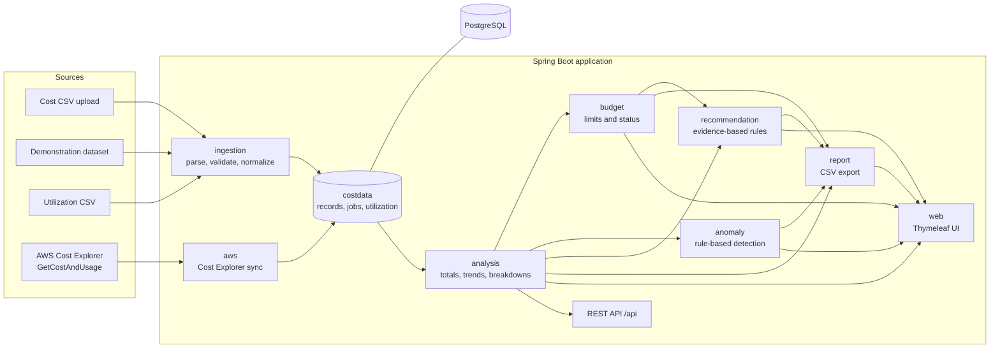
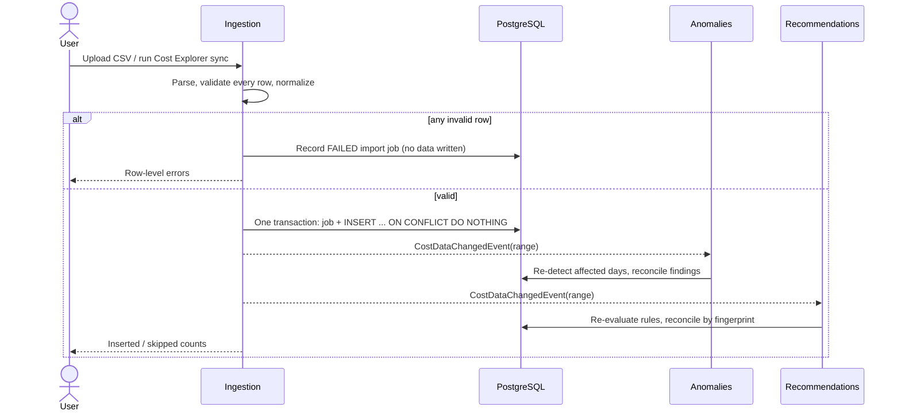
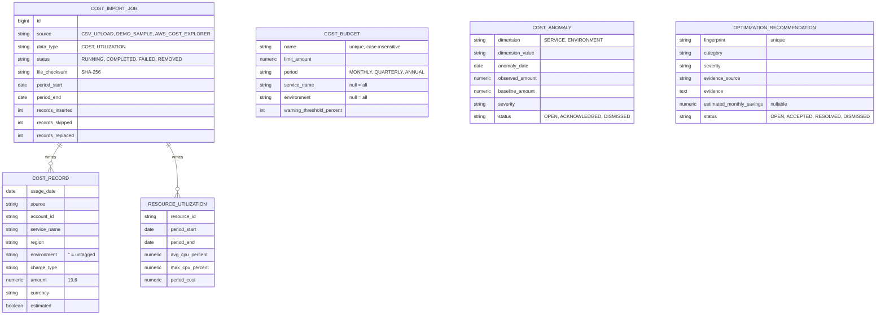
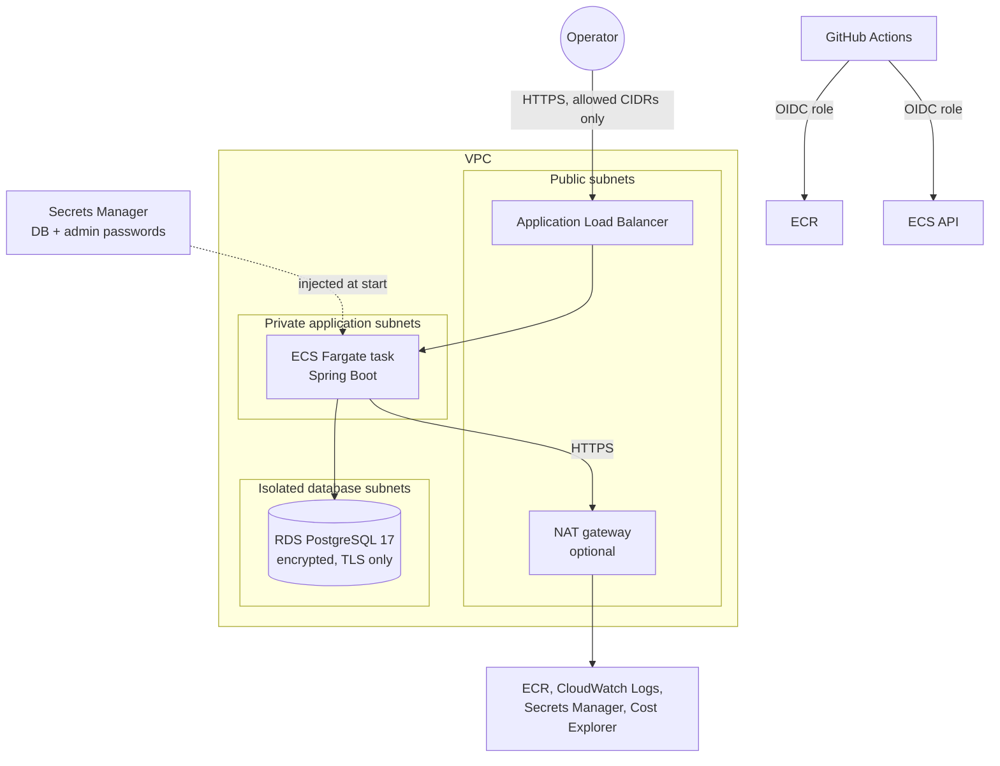

# Architecture

The platform is a **modular monolith**: one Spring Boot application, one PostgreSQL database,
packages with clear responsibilities, and no message brokers or caches. The workload (periodic
imports, interactive analysis of at most a few million daily rows) does not justify distributed
components.

## Components

| Package | Responsibility |
| --- | --- |
| `config`, `common` | Clock (UTC), security, error handling, `DateRange`, `MoneyMath` |
| `costdata` | Entities and repositories for import jobs, cost records and utilization; the data-change event |
| `ingestion` | CSV parsing and validation, normalization, idempotent bulk writes, demonstration dataset, Data Sources page |
| `aws` | Optional Cost Explorer client, synchronization, error translation, scheduled refresh |
| `analysis` | Aggregation queries (PostgreSQL `NUMERIC` sums) and period comparisons |
| `budget` | Budgets, evaluation and status rules |
| `anomaly` | Detector, detection runs and review workflow |
| `recommendation` | Rule interface, five rules, engine and reconciliation |
| `report` | CSV writer and report exports |
| `web` | Dashboard, Cost Explorer, Service Breakdown, server-rendered SVG charts |

## Data flow

Derived data (anomalies and recommendations) is recomputed from stored cost data after every
change, so it never drifts from the figures it is based on. Budget changes trigger a recommendation
re-evaluation after the budget transaction commits.

## Data model

### Uniqueness and ownership rules

| Rule | Enforced by |
| --- | --- |
| One cost amount per source, day, account, service, region, environment and charge type | `uk_cost_record_natural_key` |
| The same file content cannot be imported twice while its data is present | partial unique index on `(data_type, file_checksum) WHERE status = 'COMPLETED'` |
| At most one Cost Explorer synchronization running, across all instances | partial unique index on `source WHERE status = 'RUNNING'` |
| One anomaly per dimension value and day | `uk_cost_anomaly` |
| One recommendation per rule, subject and period | `uk_optimization_recommendation_fingerprint` |
| Budget names are unique ignoring case | unique index on `lower(name)` |

Each cost record belongs to the import job that wrote it. Removing a CSV or demonstration import
deletes exactly the rows it inserted; rows it skipped as duplicates belong to the earlier job.
A Cost Explorer synchronization replaces all previously synchronized rows in its date range.

### Conventions

- **Time**: all timestamps are `TIMESTAMPTZ` written in UTC; usage dates are UTC calendar days, as
  reported by AWS. The JVM runs with `user.timezone=UTC` in the container.
- **Money**: `NUMERIC(19,6)` in the database and `BigDecimal` in Java; sums are computed by
  PostgreSQL. Only percentages are rounded (two decimals, half-up). One reporting currency.
- **Schema**: Flyway migrations `V1`–`V5`; Hibernate runs with `ddl-auto=validate`.
- **Writes**: bulk inserts use JDBC batches with `ON CONFLICT`; JPA is used for everything else.

## Deployment architecture

See [deployment.md](deployment.md) for details and cost estimates.
